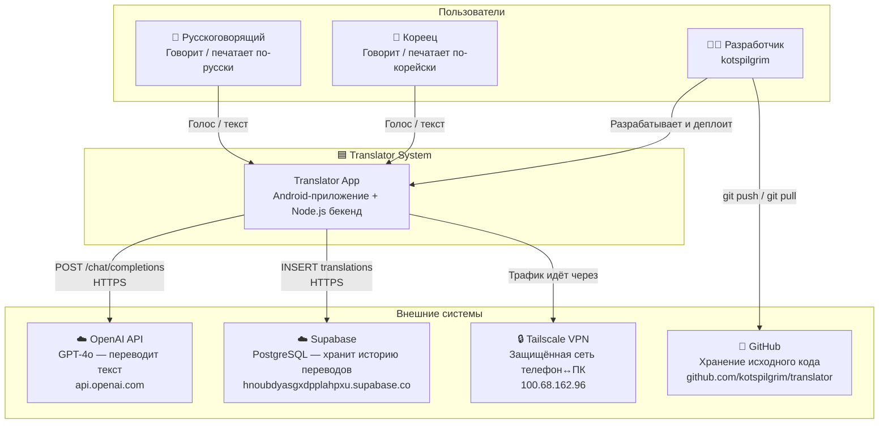
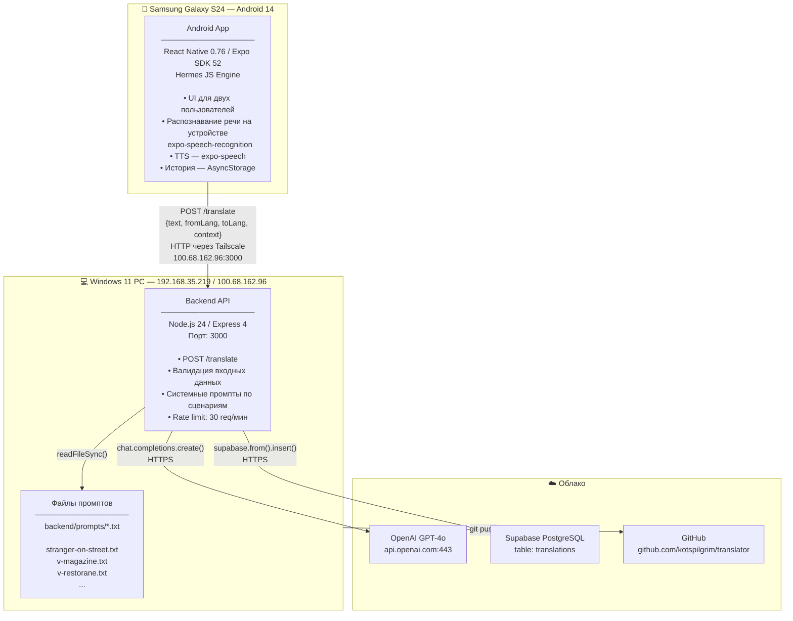
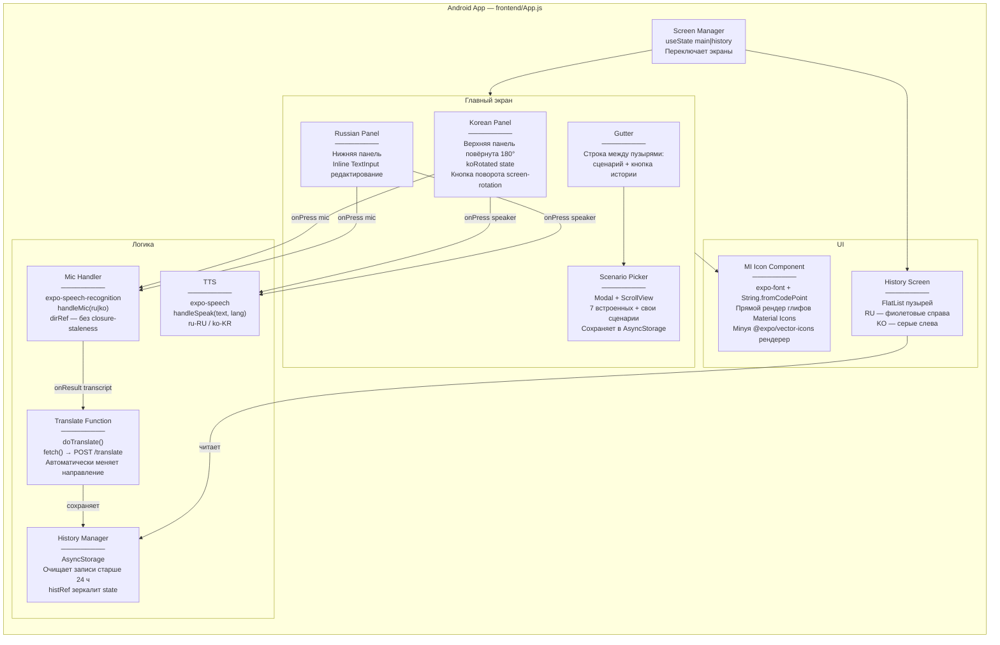
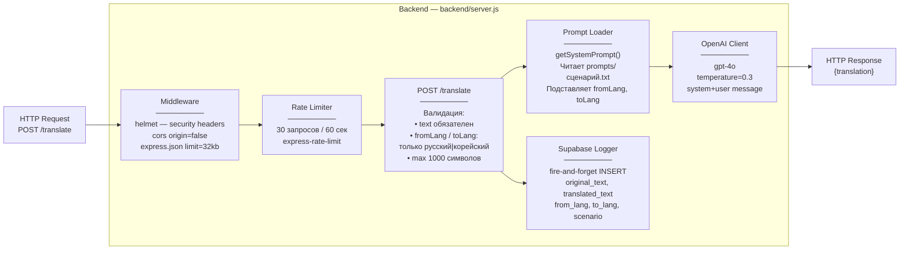
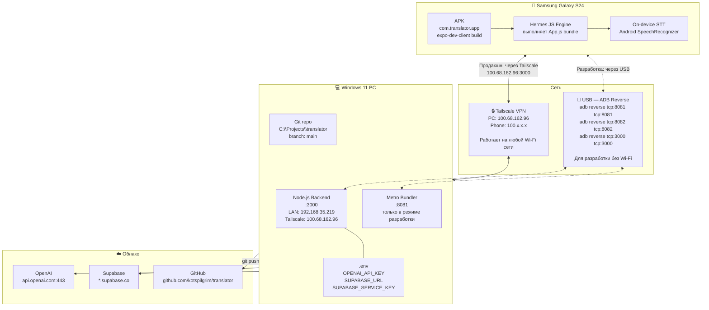
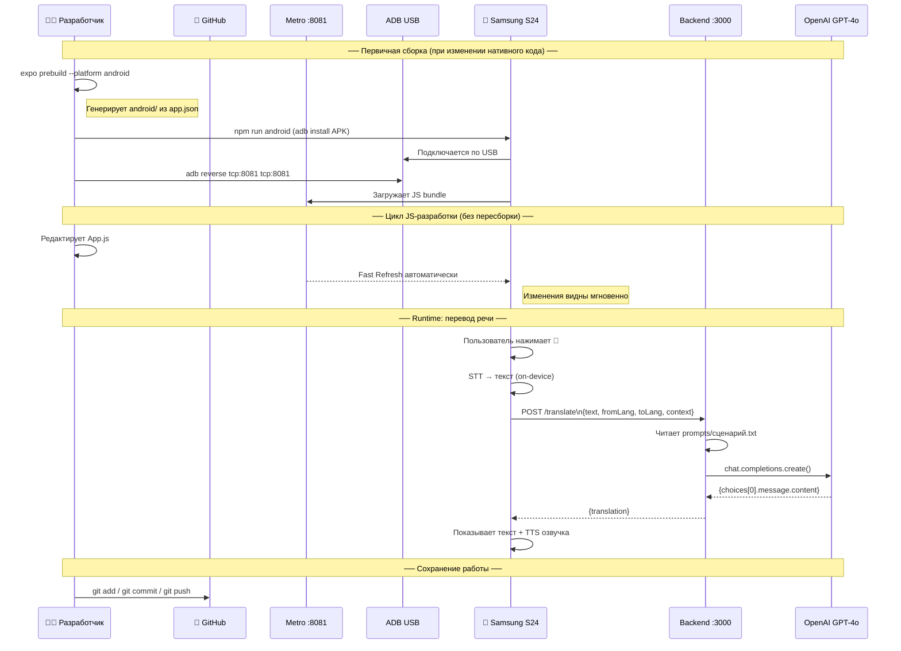

# Архитектура приложения Translator

> Двуязычный голосовой переводчик RU↔KO.
> Документ описывает архитектуру на трёх уровнях: контекст → контейнеры → компоненты,
> а также схему деплоя и процесс разработки.

---

## Уровень 1 — Контекст системы

Кто использует систему и с какими внешними сервисами она работает.



---

## Уровень 2 — Контейнеры

Из каких процессов состоит система, на каком железе они работают.



---

## Уровень 3А — Компоненты Android App

Что происходит внутри `frontend/App.js`.



---

## Уровень 3Б — Компоненты Backend

Что происходит внутри `backend/server.js`.



---

## Схема физического деплоя



---

## Процесс разработки — последовательность



---

## Конфигурация — все ключевые значения

| Параметр | Файл | Значение |
|---|---|---|
| Backend URL (Tailscale) | `frontend/App.js:25` | `http://100.68.162.96:3000` |
| Backend URL (USB-dev) | `frontend/App.js:25` | `http://localhost:3000` |
| LAN IP компьютера | `ipconfig` | `192.168.35.219` |
| Tailscale IP компьютера | Tailscale dashboard | `100.68.162.96` |
| Backend порт | `backend/server.js:13` | `3000` |
| Metro порт | по умолчанию | `8081` |
| Android package | `frontend/app.json` | `com.translator.app` |
| Expo SDK | `frontend/package.json` | `52` |
| OpenAI ключ | `backend/.env` | `OPENAI_API_KEY=sk-proj-...` |
| Supabase URL | `backend/.env` | `SUPABASE_URL=https://hnoubdyasgxdpplahpxu.supabase.co` |
| Git remote | `git remote -v` | `https://github.com/kotspilgrim/translator.git` |

---

## Структура файлов

```
translator/
├── backend/
│   ├── server.js              ← Express, маршрут POST /translate
│   ├── .env                   ← секреты (не коммитить)
│   ├── .env.example           ← шаблон без значений
│   ├── package.json
│   └── prompts/
│       ├── stranger-on-street.txt
│       ├── v-magazine.txt
│       ├── v-restorane.txt
│       ├── v-banke.txt
│       ├── v-bolnitse.txt
│       ├── v-otele.txt
│       └── v-transporte.txt
│
├── frontend/
│   ├── App.js                 ← весь UI и логика (~600 строк)
│   ├── app.json               ← конфиг Expo: иконки, плагины, права
│   ├── package.json
│   ├── assets/
│   │   ├── icon.png           ← иконка 1024×1024
│   │   ├── adaptive-icon.png  ← адаптивная иконка Android
│   │   └── splash-icon.png
│   └── android/               ← генерируется expo prebuild (не трогать)
│
├── CLAUDE.md                  ← инструкции для Claude Code
└── ARCHITECTURE.md            ← этот документ
```
