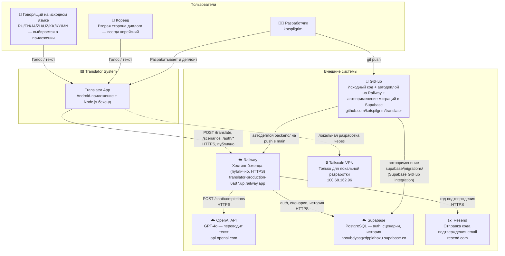
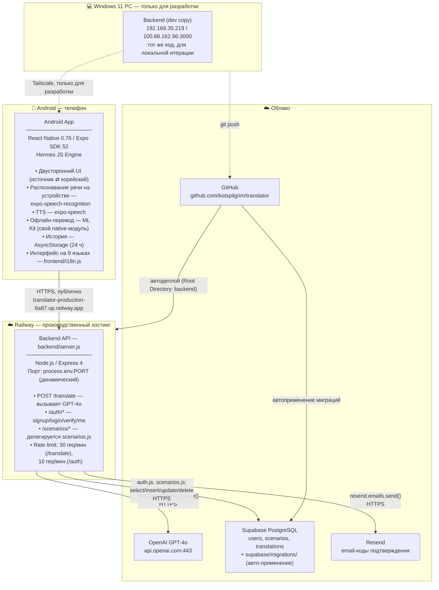
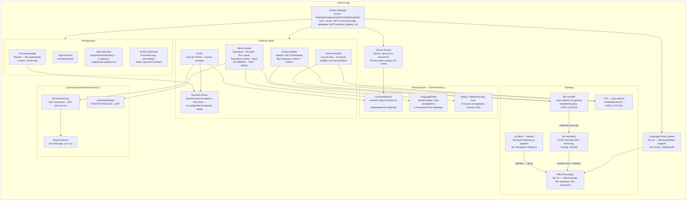
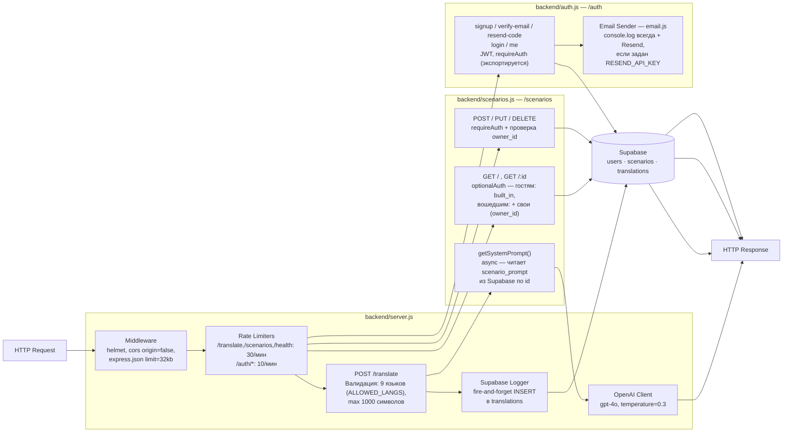
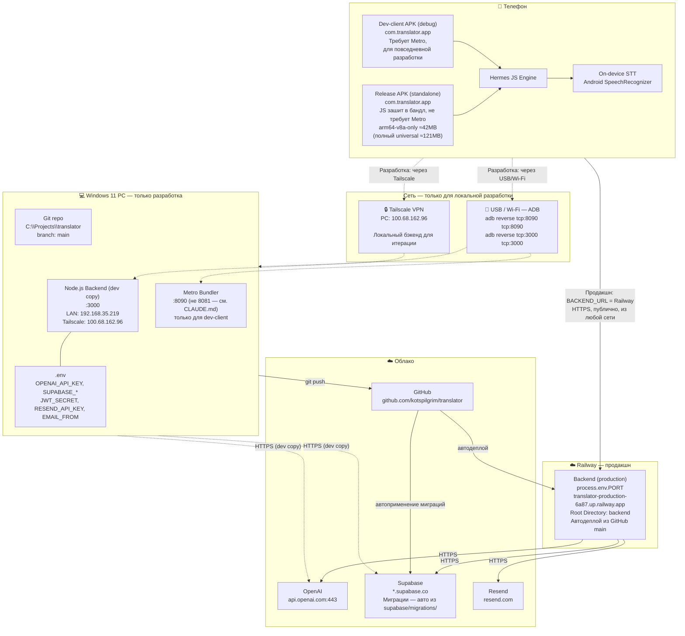
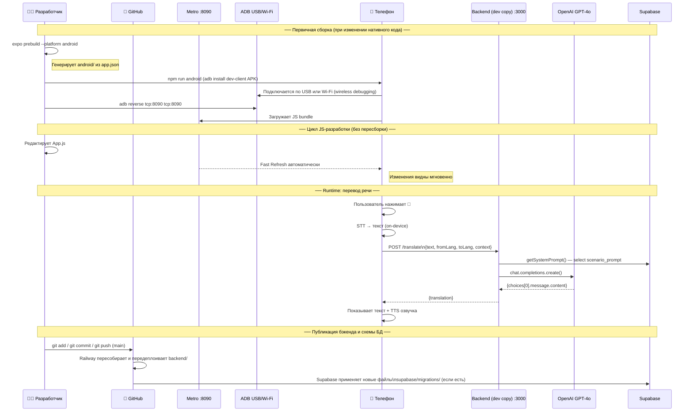

# Архитектура приложения Translator

> Двуязычный голосовой переводчик RU↔KO.
> Документ описывает архитектуру на трёх уровнях: контекст → контейнеры → компоненты,
> а также схему деплоя и процесс разработки.

---

## Уровень 1 — Контекст системы

Кто использует систему и с какими внешними сервисами она работает.



---

## Уровень 2 — Контейнеры

Из каких процессов состоит система, на каком железе они работают.



---

## Уровень 3А — Компоненты Android App

Что происходит внутри `frontend/App.js` (плюс `frontend/i18n.js` и `frontend/modules/mlkit-translate/`).



---

## Уровень 3Б — Компоненты Backend

Что происходит внутри `backend/server.js`, `backend/auth.js` и `backend/scenarios.js`.



---

## Схема физического деплоя



---

## Процесс разработки — последовательность



---

## Конфигурация — все ключевые значения

| Параметр | Файл | Значение |
|---|---|---|
| **Backend URL (продакшн)** | `frontend/App.js:37` | `https://translator-production-6a87.up.railway.app` |
| Backend URL (Tailscale, dev) | `frontend/App.js:37` (закомментированная альтернатива) | `http://100.68.162.96:3000` |
| Backend URL (USB-dev) | — | `http://localhost:3000` |
| LAN IP компьютера | `ipconfig` | `192.168.35.219` |
| Tailscale IP компьютера | Tailscale dashboard | `100.68.162.96` |
| Backend порт (Railway) | `backend/server.js` | `process.env.PORT` (динамический, Railway сам назначает) |
| Backend порт (локально) | `backend/server.js` | `3000` (фолбэк, если `PORT` не задан) |
| Metro порт | `frontend/package.json` scripts | `8090` (не 8081 — см. CLAUDE.md, конфликт с Docker Desktop) |
| Android package | `frontend/app.json` | `com.translator.app` |
| Android versionCode | `frontend/app.json` | `1` |
| Expo SDK | `frontend/package.json` | `52` |
| Railway: Root Directory | Railway Dashboard → Settings | `backend` |
| Supabase project ref | `supabase/config.toml` / CLI | `hnoubdyasgxdpplahpxu` |
| Supabase GitHub integration | Supabase Dashboard → Integrations | Working directory: `.` (корень репозитория) |
| OpenAI ключ | `backend/.env` + Railway Variables | `OPENAI_API_KEY=sk-proj-...` |
| Supabase URL | `backend/.env` + Railway Variables | `SUPABASE_URL=https://hnoubdyasgxdpplahpxu.supabase.co` |
| Resend API-ключ | `backend/.env` + Railway Variables | `RESEND_API_KEY=re_...` (опционально — без него код падает только в консоль) |
| Git remote | `git remote -v` | `https://github.com/kotspilgrim/translator.git` |

---

## Структура файлов

```
translator/
├── backend/
│   ├── server.js               ← Express: /translate, /health, монтирует auth.js и scenarios.js
│   ├── auth.js                 ← /auth/*: signup, verify-email, resend-code, login, me
│   ├── scenarios.js             ← /scenarios/*: CRUD поверх Supabase, экспортирует getSystemPrompt()
│   ├── email.js                ← sendVerificationCode() — console.log + Resend
│   ├── supabaseClient.js        ← общий Supabase-клиент (server.js, auth.js, scenarios.js)
│   ├── .env                    ← секреты (не коммитить)
│   ├── .env.example             ← шаблон без значений
│   ├── package.json
│   └── prompts/                 ← справочный текст промптов, БОЛЬШЕ НЕ читается кодом в рантайме
│       ├── stranger-on-street.txt
│       ├── v-magazine.txt
│       ├── v-restorane.txt
│       ├── v-banke.txt
│       ├── v-bolnitse.txt
│       ├── v-otele.txt
│       ├── v-transporte.txt
│       └── v-vetklinike.txt
│
├── supabase/
│   ├── config.toml               ← конфиг Supabase CLI (project_id: translator)
│   └── migrations/                ← SQL-миграции, авто-применяются на push в main
│       ├── 20260101000001_users_scenarios_auth.sql
│       ├── 20260101000002_email_verification_stub.sql
│       └── 20260101000003_scenarios_db_storage.sql
│
├── frontend/
│   ├── App.js                  ← весь UI и логика (SignIn/SignUp/History/Packs/…)
│   ├── i18n.js                  ← переводы интерфейса (9 языков) + имена сценариев
│   ├── app.json                 ← конфиг Expo: иконки, плагины, права, versionCode
│   ├── eas.json                 ← профиль production (app-bundle, autoIncrement)
│   ├── package.json
│   ├── modules/mlkit-translate/ ← локальный Expo-модуль, офлайн-перевод (Kotlin)
│   ├── assets/
│   │   ├── icon.png            ← иконка 1024×1024
│   │   ├── adaptive-icon.png   ← адаптивная иконка Android
│   │   └── splash-icon.png
│   └── android/                 ← генерируется expo prebuild, не в git
│
├── PRIVACY.md                   ← черновик политики конфиденциальности (для Play Console)
├── CLAUDE.md                    ← инструкции для Claude Code
└── ARCHITECTURE.md              ← этот документ
```
